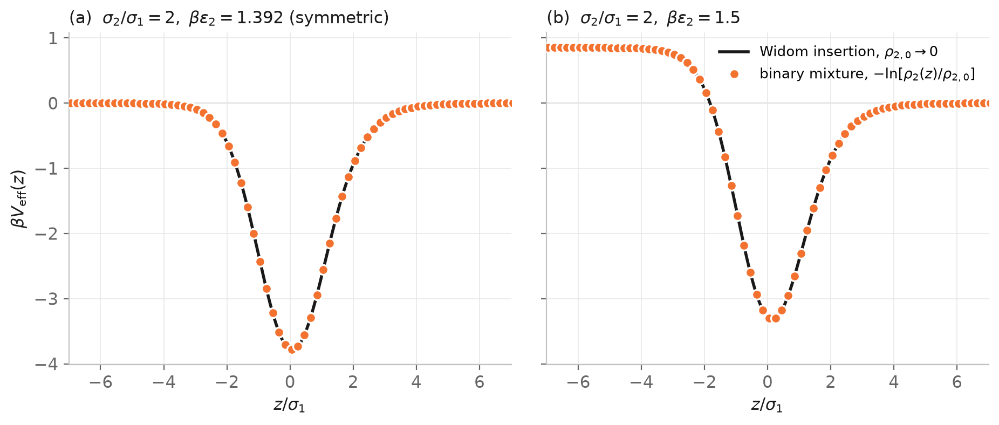
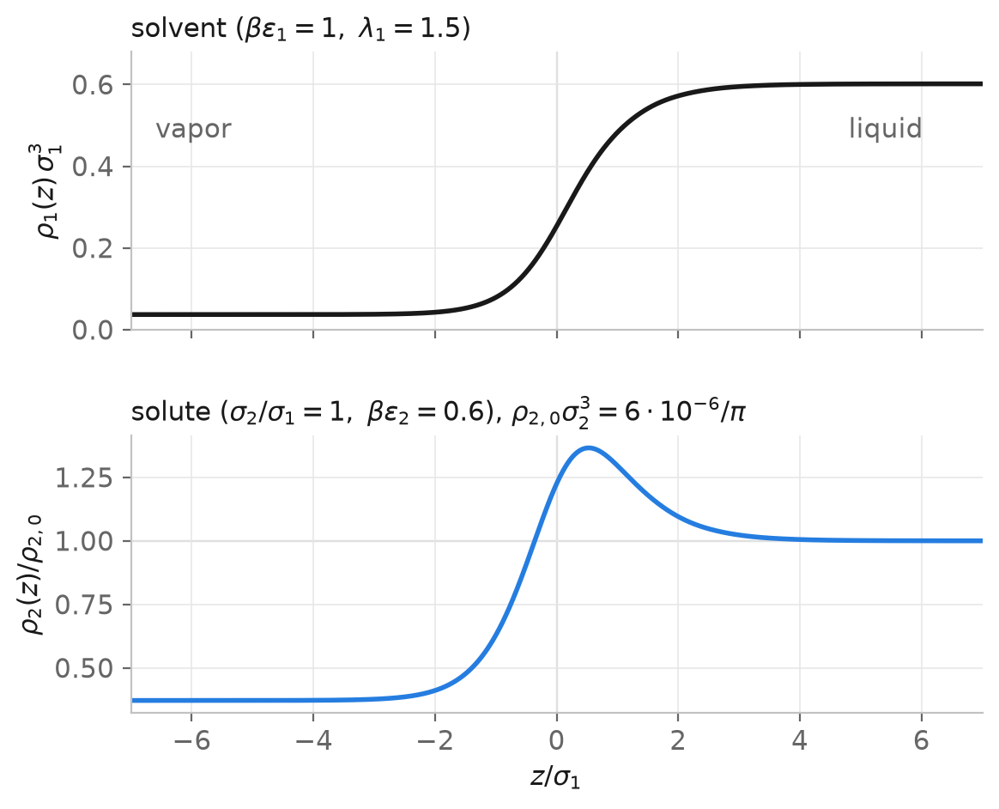
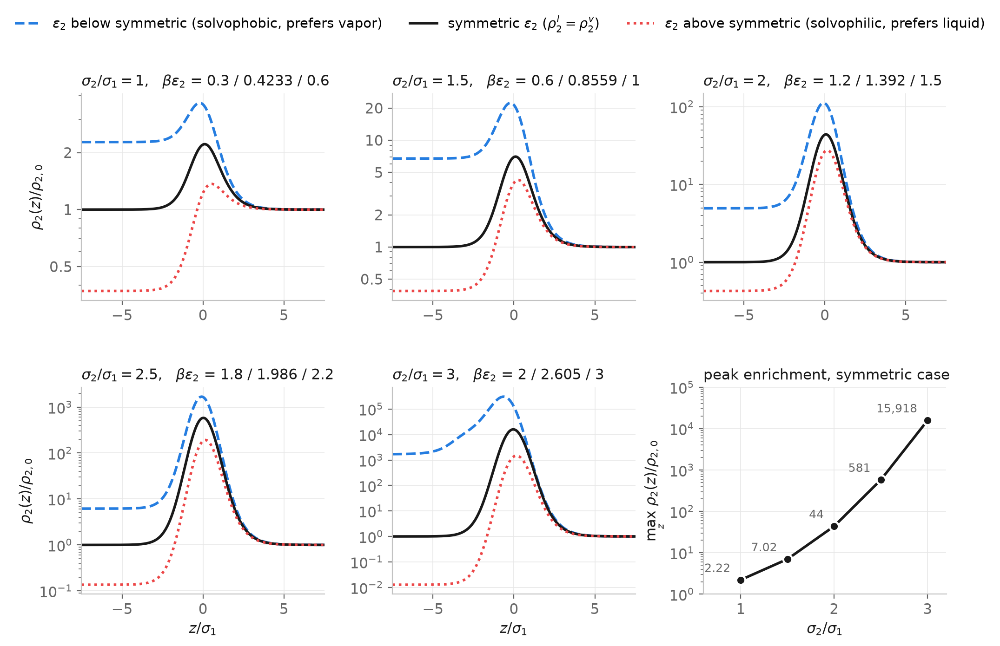
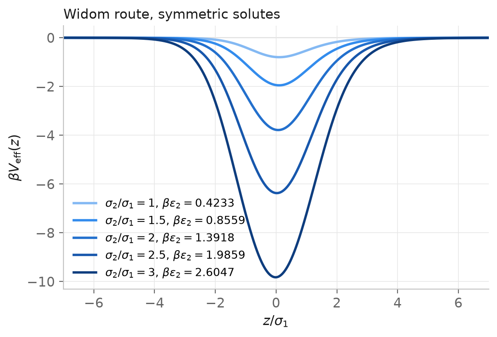

# SW-Effective-Interactions

Classical density functional theory (DFT) for **binary square-well mixtures**,
with a **new FMT-like form of the square-well functional**. The code computes
the **effective one-body potential** that a liquid-vapor interface of the
solvent exerts on dissolved nanoparticles.

This is the code behind

> M. Gül and R. Roth,
> *Effective one-body interactions due to the presence of a liquid-vapor interface*,
> Physica A **674**, 130686 (2025).
> [doi:10.1016/j.physa.2025.130686](https://doi.org/10.1016/j.physa.2025.130686) ·
> [arXiv:2608.09375](https://arxiv.org/abs/2608.09375)

<p align="center">
  
</p>
<p align="center"><sub>The interface strongly attracts the solute. The binary-mixture route (dots) and the
Widom-insertion route (line) give the same effective potential.</sub></p>

---

## Theoretical background

### Model

Both components are hard spheres with a square-well (SW) attraction:

$$
\phi_{ij}(r)=
\begin{cases}
\infty, & r\le\sigma_{ij},\\
-\epsilon_{ij}, & \sigma_{ij}<r<\lambda_{ij}\sigma_{ij},\\
0, & \text{otherwise},
\end{cases}
\qquad \sigma_{ij}=\frac{\sigma_i+\sigma_j}{2}.
$$

Component 1 is the **solvent** ($\beta\epsilon_1=1$, $\lambda_1=1.5$). It phase-separates into liquid
and vapor. Component 2 is a **dilute solute** of "nanoparticles" with diameter $\sigma_2\ge\sigma_1$
and well width $\sigma_2(\lambda_2-1)=\sigma_1(\lambda_1-1)$.

### Density functional

The grand-potential functional is

$$
\Omega[\rho_1,\rho_2]=\mathcal F_\mathrm{id}+\mathcal F_\mathrm{hs}+\mathcal F_\mathrm{sw}
-\sum_i\mu_i\int\mathrm d\mathbf r\,\rho_i(\mathbf r).
$$

The hard-sphere reference $\mathcal F_\mathrm{hs}$ is the **White-Bear** version of fundamental
measure theory (FMT). The attraction is treated in the (optimised) **random-phase approximation**,
$\beta\mathcal F_\mathrm{sw}=\tfrac12\sum_{ij}\iint\rho_i\rho_j\,\beta\phi^{ij}_\mathrm{sw}$, with the
well extended into the core.

### FMT-like square-well functional

The RPA term has the same geometric structure as the *exact* low-density limit of FMT,
$n_0n_3+n_1n_2-\mathbf n_1\cdot\mathbf n_2$. This is because the overlap volume of two spheres
can be deconvolved into single-sphere weight functions. The SW perturbation can therefore be
written with weighted densities, like FMT:

$$
\beta\mathcal F_\mathrm{sw}=\int\mathrm d\mathbf r\,
\left(n^\epsilon_0n^\epsilon_3+n^\epsilon_1n^\epsilon_2-\mathbf n^\epsilon_1\cdot\mathbf n^\epsilon_2\right),
\qquad
n^\epsilon_\alpha(\mathbf r)=\sum_i\int\mathrm d\mathbf r'\,\rho_i(\mathbf r')\,w^{\epsilon,i}_\alpha(\mathbf r-\mathbf r').
$$

The SW weights are FMT weights of a sphere with radius $\lambda_iR_i$ ($R_i=\sigma_i/2$),
multiplied by $\sqrt{\beta\epsilon_i}$:

$$
w^{\epsilon,i}_3=\sqrt{\epsilon_i}\,\Theta(\lambda_iR_i-r),\qquad
w^{\epsilon,i}_2=\sqrt{\epsilon_i}\,\delta(\lambda_iR_i-r),\qquad
w^{\epsilon,i}_1=-\frac{w^{\epsilon,i}_2}{4\pi\lambda_iR_i},\qquad
w^{\epsilon,i}_0=-\frac{w^{\epsilon,i}_2}{4\pi(\lambda_iR_i)^2},
$$

with $\mathbf w^{\epsilon,i}_2=w^{\epsilon,i}_2\,\mathbf r/r$ and
$\mathbf w^{\epsilon,i}_1=-\mathbf w^{\epsilon,i}_2/(4\pi\lambda_iR_i)$. The minus signs turn the
hard-core overlap into an attraction; without them the functional describes square shoulders.
In the bulk this gives

$$
f_\mathrm{sw}=-\sum_i\frac{2\pi}{3}\rho_i^2(\lambda_i\sigma_i)^3\epsilon_i
-\sum_{i<j}\frac{\pi}{6}\rho_i\rho_j(\lambda_i\sigma_i+\lambda_j\sigma_j)^3\sqrt{\epsilon_i\epsilon_j}.
$$

That is the RPA result for **Lorentz-Berthelot mixing**,
$\epsilon_{ij}=\sqrt{\epsilon_i\epsilon_j}$ and
$\lambda_{ij}\sigma_{ij}=(\lambda_i\sigma_i+\lambda_j\sigma_j)/2$. The mixing rule is therefore built
into the functional. An $\nu$-component mixture needs only six SW weighted densities, not
$\nu^2$ pair convolutions.

### Liquid-vapor coexistence and the free interface

The coexisting bulk phases satisfy $P^l=P^v$ and $\mu_i^l=\mu_i^v$. The solute density in the liquid
is fixed at $\rho_2^l=\rho_{2,0}=10^{-6}\times6/(\pi\sigma_2^3)$. The solvent then coexists at
$\rho_1^l\sigma_1^3=0.6016$ and $\rho_1^v\sigma_1^3=0.0370$, with
$\beta\gamma\sigma_1^2=0.20906$ for the pure solvent. For each size ratio there is a **symmetric**
$\epsilon_2^*$ at which the solute has no preference for either phase ($\rho_2^l=\rho_2^v$).

The planar profiles $\rho_i(z)$ follow from the Euler-Lagrange equation

$$
\rho_i(z)=\rho_i^l\exp\left[c^{(1)}_i(z)+\beta\mu^\mathrm{ex}_i\right],
$$

which is solved by Picard iteration.

### Effective one-body potential: two routes

Integrating out the solvent maps the mixture onto an effective one-component system of
nanoparticles. In bulk mixtures the leading effective term is a pair potential, for example
the depletion potential. Here the interface instead produces a strong **one-body** term
$V_\mathrm{eff}(z)$. It can be computed in two independent ways:

1. **From the binary mixture.** In the dilute limit
   $\rho_2(z)=\rho_{2,0}\,e^{-\beta V_\mathrm{eff}(z)}$, so
   $\beta V_\mathrm{eff}(z)=-\lim_{\rho_{2,0}\to0}\ln[\rho_2(z)/\rho_{2,0}]$. This is evaluated at
   a small but finite $\rho_{2,0}$.
2. **Widom insertion.** Move a solute particle from the bulk to height $z$. The change in grand
   potential is

$$
\beta V_\mathrm{eff}(z)=\lim_{\rho_{2,0}\to0}\left[c^{(1)}_2(\pm\infty)-c^{(1)}_2(z)\right].
$$

   Here the dilute limit is taken **exactly**. The solute's one-body direct correlation function
   is evaluated on the *pure-solvent* interface, so no solute is needed in the calculation; only
   the mixture functional is.

---

## Results

### Interface structure

<p align="center">
  
</p>

The solvent profile is a smooth sigmoid. The solute is only a trace component ($10^{-6}$), so it
barely perturbs it, but the solute itself **adsorbs at the interface**.

### Adsorption grows strongly with particle size

<p align="center">
  
</p>

Each panel shows ε₂ just below, at and just above the symmetric value. Solvophobic and
solvophilic solutes are both attracted to the interface. The interfacial enrichment grows from a
factor of about 2 for equal sizes to about 1.6·10⁴ for σ₂/σ₁ = 3. The adsorbed particles lower the
surface tension, as the Gibbs adsorption equation predicts.

<p align="center">
  
</p>

| σ₂/σ₁ | symmetric βε₂* | βγσ₁² | max ρ₂/ρ₂,₀ | min βV_eff (Widom) | max \|ΔβV_eff\| between routes |
|:-:|:-:|:-:|:-:|:-:|:-:|
| 1   | 0.4233 | 0.209051 | 2.2      | −0.80 | 3·10⁻⁵ |
| 1.5 | 0.8559 | 0.209050 | 7.0      | −1.95 | 9·10⁻⁵ |
| 2   | 1.3918 | 0.209040 | 43.9     | −3.78 | 5·10⁻⁴ |
| 2.5 | 1.9859 | 0.208967 | 581      | −6.37 | 7·10⁻³ |
| 3   | 2.6047 | 0.207806 | 15 918   | −9.82 | 0.22   |

The two routes to $V_\mathrm{eff}$ agree up to σ₂/σ₁ = 2.5. At σ₂/σ₁ = 3 the interface is enriched
so much that the local solute packing fraction reaches about 1.6 %. The finite-$\rho_{2,0}$ mixture
route then starts to depart from the strict dilute limit. The Widom route has no such issue.

---

## Repository layout

```
src/                     C solver
  sw_interface.c           planar interface, coexistence, both V_eff routes
  white_bear.c/.h          White-Bear FMT and FMT-like SW functional, bulk thermodynamics
  Makefile
scripts/
  run_paper.sh             runs every calculation shown in the paper
  make_figures.py          figures and summary table in this README
  gibbs_adsorption.py      Gibbs dividing surface, solute adsorption, surface tension estimate
mathematica/
  binary_coexistence.nb    bulk binary coexistence and symmetric ε₂* (cross-check of the C solver)
  veff.nb                  bulk chemical potentials for the Widom route
docs/figures/            README figures
```

## Building and running

Requirements: a C11 compiler, optionally with OpenMP, and Python ≥ 3.10 with `numpy` and
`matplotlib` for the figures.

```bash
make -C src                      # OpenMP is used if the compiler supports it; on macOS
                                 # e.g. make -C src CC=gcc-15 for a parallel build

# one calculation: sigma2/sigma1 = 2, symmetric eps2
src/sw_interface -q 2 -s -o data/runs

# everything in the paper (17 runs, ~1 min on 10 cores), then the figures
scripts/run_paper.sh
pip install -r requirements.txt
python scripts/make_figures.py
```

`sw_interface` options:

| option | meaning | default |
|---|---|---|
| `-q` | size ratio σ₂/σ₁ (a multiple of 1/`grid`) | 2.0 |
| `-e` | βε₂ of the solute | 1.3918 |
| `-s` | solve for the symmetric βε₂* ($\rho_2^l=\rho_2^v$); `-e` is the initial guess | off |
| `-l` | λ₂ | 1 + (λ₁−1)/q |
| `-E`, `-L` | βε₁, λ₁ of the solvent | 1.0, 1.5 |
| `-x` | solute packing fraction $\rho_{2,0}$ in the liquid | 10⁻⁶ |
| `-g` | grid points per σ₁/2 | 60 |
| `-a`, `-n`, `-t` | Picard mixing, max. iterations, tolerance | 0.01, 75000, 10⁻¹⁴ |
| `-o` | output directory | `.` |

The solver first finds the binary liquid-vapor coexistence itself, so no densities have to be
supplied. It writes two files, each with a header listing all parameters, the coexisting
densities, the pressure and $\beta\gamma\sigma_1^2$:

* `profile_q<q>_eps<eps2>.dat`: columns $z/\sigma_1$, $\rho_1\sigma_1^3$, $\rho_2\sigma_1^3$, $\eta(z)=n_3(z)$
* `veff_q<q>_eps<eps2>.dat`: columns $z/\sigma_1$, $\beta V_\mathrm{eff}$ (mixture route), $\beta V_\mathrm{eff}$ (Widom route)

## Citation

If you use this code, please cite

```bibtex
@article{Gul2025EffectiveOneBody,
  author  = {G{\"u}l, Melih and Roth, Roland},
  title   = {Effective one-body interactions due to the presence of a liquid-vapor interface},
  journal = {Physica A: Statistical Mechanics and its Applications},
  volume  = {674},
  pages   = {130686},
  year    = {2025},
  doi     = {10.1016/j.physa.2025.130686},
  eprint  = {2608.09375},
  archivePrefix = {arXiv}
}
```

Institute for Theoretical Physics, University of Tübingen.
